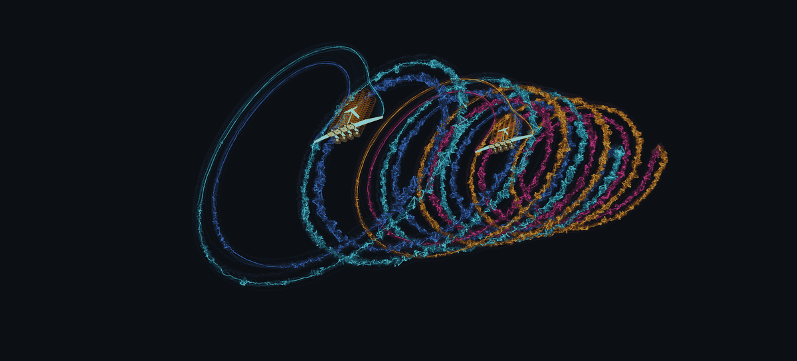
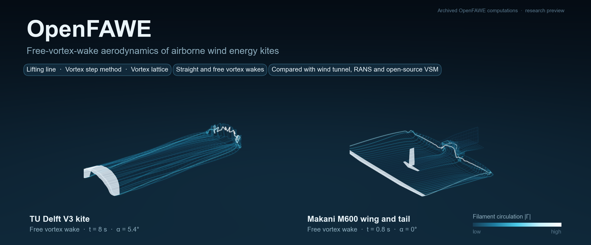

<p align="center">
  
</p>

<h1 align="center">OpenFAWE</h1>

<p align="center">
  <b>Free-vortex-wake aerodynamics for airborne wind energy kites</b><br>
  vortex step method · time-marching free wake · rotor vortex rings · several kites in one wake · CPU and GPU tree codes
</p>

<p align="center">
  <a href="https://doi.org/10.48550/arXiv.2610.37313"></a>
  <a href="https://github.com/robytian/OpenFAWE/releases/latest"></a>
  
  
  
  
</p>

<p align="center">
  <a href="#what-it-computes">What it computes</a> ·
  <a href="#results-of-the-paper">Results</a> ·
  <a href="#quick-start">Quick start</a> ·
  <a href="#reproduce-the-paper">Reproduce the paper</a> ·
  <a href="#cite">Cite</a>
</p>

---

The animation above is one lap of two Makani M600 kites flying the same crosswind loop, one loop
diameter apart, each with its eight rotors. Every line is a computed vortex filament: the trailing
vorticity of each wing rolls up into a **pair of counterrotating helical tip vortices** (blue and cyan
for the first kite, magenta and orange for the second), the rotors release vortex rings, and the wake
of the first kite winds downstream until it reaches the second one. The kites are drawn three times
their size so that they can be seen.

## What it computes

| | |
|---|---|
| **Wing aerodynamics** | Lifting line, vortex step method (VSM) and vortex-lattice lifting surface, each with a straight wake or a time-marching free vortex wake; Newton solution of the circulation closure with section polars |
| **Biot–Savart** | Lamb–Oseen regularised kernel; NumPy reference, compiled (Numba) direct sum, Barnes–Hut tree code on the CPU and a tree code on the GPU (Numba CUDA) |
| **Rotors** | Actuator discs with the Makani Rev4 rotor tables, releasing one vortex ring per rotor and time step into the same free wake |
| **Flight** | Prescribed rigid-body motions: the nominal crosswind loop of the Makani M600 controller, pitch manoeuvres, several kites in one vortex system |
| **Tether** | Lumped-mass tether with bridle, run with the prescribed motion |
| **Models** | TU Delft V3 leading-edge inflatable kite, Makani M600 wing and tails, rotors, playbook and ground station |
| **Output** | Run archives with settings, per-step loads and commit hashes; stored wake networks; ParaView (VTP/PVD) export; PyVista renders |

## Results of the paper

From Y. Tian, S. Wang, *Free-vortex-wake dynamics of airborne wind energy kites in crosswind flight*,
[arXiv:2610.37313](https://doi.org/10.48550/arXiv.2610.37313) (2026):

| | |
|---|---|
| **Verification** | Reproduces an independent vortex step code to 10⁻⁹ on the rigid-wing Makani M600 and within 0.3 % in lift and 0.9 % in drag on the TU Delft V3 kite, whose RANS lift it matches within 3.1 % |
| **Finite wakes** | For fixed kites the lift deficit of a finite wake is the far field of its starting vortex, which fixes the wake length before a run; the vortex core must stay below the narrowest panel width |
| **Kite on its loop** | The helical tip-vortex pair of the M600 lowers its lift by about 0.5 % from 5 to 13 m/s |
| **Rotor slipstreams** | Free rotor rings do not converge with the time step; an undeformed slipstream tube converges and raises the lift by 1.9 %, a slipstream deflected by the wing lowers it by 3.5 % |
| **Two kites** | A second unit one loop diameter downstream loses 0.5 % of its lift and 2.2 % of its aerodynamic power, with or without rotors |

<p align="center">
  
</p>
<p align="center"><sub>Free wakes of the TU Delft V3 kite and the Makani M600 after an impulsive start: archived 40-step states, an illustration of the method rather than a convergence result.</sub></p>

## Quick start

Python 3.12 or newer.

```bash
git clone https://github.com/robytian/OpenFAWE.git && cd OpenFAWE
python -m venv .venv
.venv/bin/pip install -e ".[fast,paper,test]"      # Windows: .venv\Scripts\pip
.venv/bin/python -m pytest tests                     # 586 tests
```

One M600 on its crosswind loop at 9 m/s with its tether, a few steps on the CPU tree code:

```bash
.venv/bin/python paper1/crosswind/c3_pair.py local/runs/demo --single --laps 1 --steps 50
```

Two kites one loop diameter apart, with the eight rotors and their vortex rings, as in the paper
(add `--backend cuda_tree` on a computer with an NVIDIA GPU):

```bash
.venv/bin/python paper1/crosswind/c3_pair.py local/runs/pair --spacing 1.0 --laps 5 \
    --rotors 97.4 --keep-ring-steps 100 --ring-drift --ring-sheet-drift --ring-ambient-spacing \
    --ring-surface-overlap 2 --ring-surface-core 0.1 --ring-core 0.45 --save-final --frames 24
```

A run writes `history.json` and `checks.json` (settings, verdicts, loads) and the stored wake networks
`state_<step>.npz`. The versions of the paper runs are pinned in
[`requirements-paper1.txt`](requirements-paper1.txt).

## Reproduce the paper

Everything behind the figures and tables of the arXiv paper is in [`paper1/`](paper1):

- [`paper1/scripts`](paper1/scripts), [`paper1/extra`](paper1/extra), [`paper1/fig`](paper1/fig): the
  method and verification part (convergence ladders, tree code, wake length, vortex core, closure
  conditioning) with their job lists and evidence files;
- [`paper1/crosswind`](paper1/crosswind): the kite on its loop, the rotor slipstreams and the two kites,
  with the command line of every run in [`RUNS.md`](paper1/crosswind/RUNS.md), the read-back files in
  `results/` and the receipts of the production runs in `receipts/`.

Every run records the commit of the code that produced it; the manifests list the origin and SHA-256 of
every published file. The complete time histories and wake networks (several GB) are not in the
repository and are regenerated by the run scripts.

## Repository layout

| Folder | Content |
|---|---|
| [`src/openfawe`](src/openfawe) | `aero` (wing methods, wakes, Biot–Savart backends), `rotor`, `flight`, `tether`, archives and rendering |
| [`cases`](cases) | Kite, rotor, tether, playbook and ground-station models |
| [`tests`](tests) | Unit and regression tests |
| [`paper1`](paper1) | Code and data of the arXiv paper |
| [`docs`](docs) | Method comparison report, design documents, figures and the media of this page |
| [`third_party`](third_party) | Licences and file-level attributions of the ported and transcribed sources |

## Cite

```bibtex
@misc{Tian2026OpenFAWE,
  author        = {Tian, Yinong and Wang, Shan},
  title         = {Free-vortex-wake dynamics of airborne wind energy kites in crosswind flight},
  year          = {2026},
  eprint        = {2610.37313},
  archivePrefix = {arXiv},
  doi           = {10.48550/arXiv.2610.37313}
}
```

The software itself is described in [`CITATION.cff`](CITATION.cff) (GitHub: *Cite this repository*).

## Status

OpenFAWE is independent research carried out and funded by the author. This release contains the
aerodynamic module with the rotor, flight and tether models that the paper uses; control, ground station,
power and floating-platform models are under development and will be released after the papers that
describe them. Results are research output and are not validated for design use.

## Licence

Source code, models, scripts and data: Copyright (c) 2026 Yinong Tian, Apache License 2.0; see
[LICENSE](LICENSE) and [NOTICE](NOTICE). The OpenFAWE algorithms ported from the Vortex-Step-Method
(MIT) and OpenFAST/OLAF (Apache-2.0) and the Makani M600 models and routines (Apache-2.0) keep their
licences; see [THIRD_PARTY_NOTICES.md](THIRD_PARTY_NOTICES.md) and [`third_party/`](third_party).
The Windows research-preview program under Releases: see [LICENSE-BINARIES.md](LICENSE-BINARIES.md).

Questions and bug reports: please open an issue.

## 中文说明

OpenFAWE 是作者自费开展的独立研究，做空中风能风筝的自由涡尾迹气动计算。本版本公开了 arXiv 论文
（arXiv:2610.37313）用到的全部代码、模型、运行脚本和结果数据：涡步法与自由尾迹、CPU 与 GPU 树算法、
旋翼涡环、规定运动下的环路飞行与多机同一尾迹、集中质量系绳，以及 M600 和 V3 风筝模型。控制、地面站、
发电和漂浮平台等模块仍在开发，将在相关论文发表后逐步开源。计算结果为研究结果，不能用于设计。
