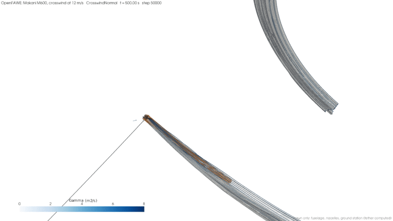
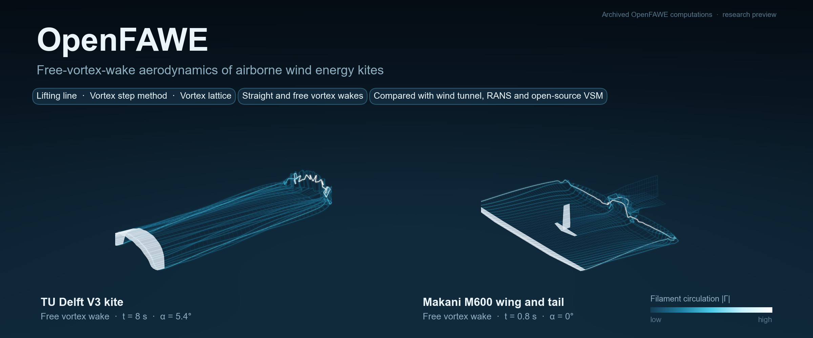

<p align="center">
  <a href="docs/media/openfawe-v1-whole-flight-12ms.mp4">
    
  </a>
</p>

<h1 align="center">OpenFAWE</h1>

<p align="center">
  <b>Free-vortex-wake aerodynamics and whole-flight simulation of airborne wind energy kites</b><br>
  OpenFAWE Studio · Makani M600 from perch to crosswind power and back · ground station, winch, tether, rotors, power system · CPU and GPU
</p>

<p align="center">
  <a href="https://github.com/robytian/OpenFAWE/releases/latest"></a>
  <a href="https://doi.org/10.48550/arXiv.2610.37313"></a>
  
  
  
</p>

<p align="center">
  <a href="#openfawe-studio-10">OpenFAWE Studio 1.0</a> ·
  <a href="#example-flights">Example flights</a> ·
  <a href="#speed">Speed</a> ·
  <a href="#how-it-was-checked">How it was checked</a> ·
  <a href="#results-of-the-paper">Paper 1</a> ·
  <a href="#cite">Cite</a>
</p>

---

The animation above is 48 s of crosswind flight at 12 m/s, six times faster than real time: the Makani
M600 flies its loops with the eight rotors working as turbines, and the free vortex wake shed by its wing
and rotors winds downstream, each filament coloured by the size of its circulation (0 to 8 m²/s). Click it
for the whole flight (118 s, twelve times faster than real time): the M600 rises from its perch, hovers
while the tether is paid out, transitions into 24 crosswind loops and returns to the perch, with the electrical
power at the ground station and the energy so far drawn below the flight. The wake drawn
is the computed one, saved every 0.5 s of flight in the vortex modes; in the hover modes the aircraft
flies on Makani's aerodynamic tables and no wake is drawn.

## OpenFAWE Studio 1.0

A Windows program that flies the Makani M600 energy kite with Makani's own flight controller, from the
perch to crosswind power generation and back to the perch, and shows it in 3-D while it computes.

| | |
|---|---|
| **Whole flight** | Perch, hover, payout, transition, crosswind loops, transition out, reel-in and landing on the perch, flown by Makani's M600 flight controller (compiled from Makani's source) |
| **Ground system** | GS02 ground station with its winch, drum and levelwind; variable-length lumped-mass tether with bridle |
| **Power** | Eight rotors on Makani's Rev4 tables, motors and the stacked power system; the ground energy of every flight mode |
| **Aerodynamics** | Makani's aerodynamic database, or the vortex step method with a free vortex wake and rotor rings in the flying modes |
| **Short windows** | Six vortex models (VSM, lifting line, vortex lattice; free or straight wake), fixed in the wind, a circular crosswind loop or Makani's nominal loop, with gusts and wind shear |
| **Hardware** | Tree code on all CPU cores, or an NVIDIA GPU for the wake sums; chosen automatically |
| **Output** | Replay with a time line and live plots of any recorded quantity; ParaView (VTP/PVD), CSV, screenshots, GIF and MP4 videos |

**Get it:** download `OpenFAWE-Studio-1.0.0-win64.zip` from
[Releases](https://github.com/robytian/OpenFAWE/releases), check its SHA-256 against the release page,
unzip it and run `OpenFAWE Studio.exe` (the program is not code-signed: "More info", then "Run anyway").
Then **Open run** (it opens the program's examples folder) → `e4-tables-10ms\run` → **Play replay**, or press
**Run** to fly yourself.
`start /wait "" "OpenFAWE Studio.exe" --self-test` checks an installation in about a minute.
Windows 10 or 11, 64-bit; 8 GB of memory (16 GB for long vortex flights); about 3 GB of disk for the program and
the examples.

The [user guide](docs/user-guide.md) ([中文](docs/user-guide.zh.md)) explains every panel, the example
flights, the output files and how the program was checked.

## Example flights

| Example | Aerodynamics | Wind | Shows |
|---|---|---|---|
| `e4-tables-10ms` | Makani's aerodynamic database | uniform 10 m/s | the whole flight with the power system, mode by mode |
| `bprime6-vortex-10ms` | free vortex wake in the flying modes, tables in hover | uniform 10 m/s | the wake of a whole flight |
| `vortex-8ms` | as above | uniform 8 m/s | crosswind loops that still use more energy than they make |
| `vortex-12ms` | as above | uniform 12 m/s | the flight of the animation above |
| `vortex-shear-10ms` | as above | wind shear 1/7, 10 m/s at 21 m | more power from the faster wind at the kite's height |
| `f3-vortex-turbulent` | as above | IEC 61400-1 normal turbulence, mean 10 m/s | the whole flight in turbulent wind |
| `cycle-power-curve` | tables; vortex | 6–14 m/s | break-even crosswind time of a whole flight (CSV) |

## Speed

The induced velocity of the free wake on 20 570 targets, computed from the source code on a rented Linux server
(NVIDIA RTX 4090 D, 22 CPU threads), median of five calls:

| Wake | CPU, 1 thread | CPU, 22 threads | GPU, double | GPU, mixed |
|---|---|---|---|---|
| 468 rows, 102 k segments | 2.07 s | 0.16 s | 0.14 s | 0.07 s |
| 936 rows, 205 k segments | 2.26 s | 0.20 s | 0.19 s | 0.13 s |
| 1 872 rows, 410 k segments | 2.59 s | 0.27 s | 0.30 s | 0.39 s |
| 3 744 rows, 820 k segments | 3.43 s | 0.52 s | 0.53 s | 0.52 s |

The exact direct sum takes 6.6–50 s on the same 22 threads. Every mode agrees with the CPU tree code:
the GPU in double precision to within 2e-15 m/s, in mixed precision within a tenth of the tree code's own error.

## How it was checked

Each part was checked on its own, then coupled and checked again; the
[validation chapter](docs/user-guide.md#validation) gives every check with its reference, method and result:
the aerodynamics against wind-tunnel, RANS and open-source vortex-step results; the free wake's convergence;
Makani's controller rebuilt from source and compared across machines; the tether and ground station
against Makani's own C++ models; the closed energy account of the whole flight; and repeatability.

## Results of the paper

From Y. Tian, S. Wang, *Free-vortex-wake dynamics of airborne wind energy kites in crosswind flight*,
[arXiv:2610.37313](https://doi.org/10.48550/arXiv.2610.37313) (2026):

| | |
|---|---|
| **Verification** | Reproduces an independent vortex step code to 10⁻⁹ on the rigid-wing Makani M600 and within 0.3 % in lift and 0.9 % in drag on the TU Delft V3 kite, whose RANS lift it matches within 3.1 % |
| **Finite wakes** | For fixed kites the lift deficit of a finite wake is the far field of its starting vortex, which fixes the wake length before a run; the vortex core must stay below the narrowest panel width |
| **Kite on its loop** | The helical tip-vortex pair of the M600 lowers its lift by about 0.5 % from 5 to 13 m/s |
| **Rotor slipstreams** | Free rotor rings do not converge with the time step; an undeformed slipstream tube converges and raises the lift by 1.9 %, a slipstream deflected by the wing lowers it by 3.5 % |
| **Two kites** | A second unit one loop diameter downstream loses 0.5 % of its lift and 2.2 % of its aerodynamic power, with or without rotors |

<p align="center">
  
</p>
<p align="center"><sub>Free wakes of the TU Delft V3 kite and the Makani M600 after an impulsive start: archived 40-step states, an illustration of the method rather than a convergence result.</sub></p>

## Source code: quick start

Python 3.12 or newer.

```bash
git clone https://github.com/robytian/OpenFAWE.git && cd OpenFAWE
python -m venv .venv
.venv/bin/pip install -e ".[fast,paper,test]"          # Windows: .venv\Scripts\pip
.venv/bin/python -m unittest discover -s tests -t .      # 831 tests
```

Two of the 831 tests fail, and are published as they are. They are the variable-length tether at full
length against the fixed-length one (`tests/test_variable_line.py`: 7.8e-11 against the bound of 1e-12
written first) and the kite at rest on the perch (`tests/test_perch.py`: 40 mm and 0.8° within 10 s against
5 mm and 0.1°). Both come from methods taken over from Makani as they are, and the program was not changed
to pass them; [section 11 of the user guide](docs/user-guide.md#11-scope-and-limitations) gives the causes.
Eight tests of release 0.2.0 compare with development records or use modules that are not published and
stop with an error; 17 are skipped, each with its reason.

One M600 on its crosswind loop at 9 m/s with its tether, a few steps on the CPU tree code:

```bash
.venv/bin/python paper1/crosswind/c3_pair.py local/runs/demo --single --laps 1 --steps 50
```

Two kites one loop diameter apart, with the eight rotors and their vortex rings, as in the paper
(add `--backend cuda_tree` on a computer with an NVIDIA GPU):

```bash
.venv/bin/python paper1/crosswind/c3_pair.py local/runs/pair --spacing 1.0 --laps 5 \
    --rotors 97.4 --keep-ring-steps 100 --ring-drift --ring-sheet-drift --ring-ambient-spacing \
    --ring-surface-overlap 2 --ring-surface-core 0.1 --ring-core 0.45 --save-final --frames 24
```

A run writes `history.json` and `checks.json` (settings, verdicts, loads) and the stored wake networks
`state_<step>.npz`. The versions of the paper runs are pinned in
[`requirements-paper1.txt`](requirements-paper1.txt).

## Reproduce the paper

Everything behind the figures and tables of the arXiv paper is in [`paper1/`](paper1):

- [`paper1/scripts`](paper1/scripts), [`paper1/extra`](paper1/extra), [`paper1/fig`](paper1/fig): the
  method and verification part (convergence ladders, tree code, wake length, vortex core, closure
  conditioning) with their job lists and evidence files;
- [`paper1/crosswind`](paper1/crosswind): the kite on its loop, the rotor slipstreams and the two kites,
  with the command line of every run in [`RUNS.md`](paper1/crosswind/RUNS.md), the read-back files in
  `results/` and the receipts of the production runs in `receipts/`.

Every run records the commit of the code that produced it; the manifests list the origin and SHA-256 of
every published file. The complete time histories and wake networks (several GB) are not in the
repository and are regenerated by the run scripts.

## Repository layout

| Folder | Content |
|---|---|
| [`src/openfawe`](src/openfawe) | `aero` (wing methods, wakes, Biot–Savart backends), `rotor`, `flight` (with the interface to Makani's flight controller), `tether`, `ground` (ground station, perch, winds, the whole flight), `power`, archives and rendering |
| [`apps/studio`](apps/studio) | OpenFAWE Studio: the program, its packaging scripts and its tests |
| [`cases`](cases) | Kite, rotor, tether, playbook and ground-station models |
| [`tests`](tests) | Unit and regression tests |
| [`paper1`](paper1) | Code and data of the arXiv paper |
| [`docs`](docs) | The user guide of OpenFAWE Studio, the method comparison report, design documents, figures and the media of this page. Its `tasks` subfolder holds what the program loads at run time (the whole flight on the vortex method, the power settings, the energy account) and the build of Makani's controller without the GNU Scientific Library; the folder names there carry the numbers of development records that are not published |
| [`third_party`](third_party) | Licences and file-level attributions of the ported and transcribed sources; Makani's flight controller compiled as a Windows library |

## Cite

```bibtex
@misc{Tian2026OpenFAWE,
  author        = {Tian, Yinong and Wang, Shan},
  title         = {Free-vortex-wake dynamics of airborne wind energy kites in crosswind flight},
  year          = {2026},
  eprint        = {2610.37313},
  archivePrefix = {arXiv},
  doi           = {10.48550/arXiv.2610.37313}
}
```

The software itself is described in [`CITATION.cff`](CITATION.cff) (GitHub: *Cite this repository*).

## Status

OpenFAWE is independent research carried out and funded by the author. The source code here is the
aerodynamic module with the rotor, flight and tether models of paper 1 (release 0.2.0) and, from release
1.0.0, the source of what OpenFAWE Studio runs: the whole flight - the interface to Makani's controller, the
ground station, winch and power system - and the program itself. It is the code the Windows program is
built from, published as it is, with the internal labels of its development records still in the comments.
The offshore edition (floating platform, mooring, two kites on a shared mooring) is the next version.
Results are research output and are not validated for design use.

## Licence

Source code, models, scripts and data: Copyright (c) 2026 Yinong Tian, Apache License 2.0; see
[LICENSE](LICENSE) and [NOTICE](NOTICE). The OpenFAWE algorithms ported from the Vortex-Step-Method
(MIT) and OpenFAST/OLAF (Apache-2.0) and the Makani M600 models and routines (Apache-2.0) keep their
licences; see [THIRD_PARTY_NOTICES.md](THIRD_PARTY_NOTICES.md) and [`third_party/`](third_party).
The Windows programs under Releases (OpenFAWE Studio, the Wake Viewer): free for non-commercial use, see
[LICENSE-BINARIES.md](LICENSE-BINARIES.md). Makani's flight controller in OpenFAWE Studio is compiled from
Makani's source (Apache-2.0) without the GNU Scientific Library.

Questions and bug reports: please open an issue.

## 中文说明

OpenFAWE 是作者自费开展的独立研究，做空中风能风筝的自由涡尾迹气动与整次飞行仿真。1.0 版（陆地版）新增 Windows 程序
OpenFAWE Studio：用 Makani 自己的飞行控制器，让 M600 从栖架起飞，悬停、放绳、转换，进入横风圈发电，再落回栖架；
地面站、绞盘、系绳、八个旋翼、电机与电力系统一起算，机翼可用 Makani 的气动表或自由涡尾迹方法，并实时看到尾迹。
程序带算例与结果，下载解压即用，使用说明见[帮助文档](docs/user-guide.zh.md)。arXiv 论文（arXiv:2610.37313）用到的
源代码按 Apache-2.0 公开；从 1.0.0 起，Studio 运行的那部分源代码（整次飞行、与 Makani 控制器的接口、地面站、绞盘与电力系统，
以及程序本身）也一并公开，就是打包程序所用的那份代码。源码的 831 项测试里有两项没有通过、照原样公布：变长系绳满长时
与定长系绳的一致（7.8e-11，最初写的界是 1e-12）和风筝在栖架上静止（10 s 内 40 mm、0.8°，界 5 mm、0.1°）；两处都来自照搬的
Makani 做法，程序没有为通过而改动，原因见[帮助文档](docs/user-guide.zh.md)第 11 节。漂浮式在下一版。
计算结果为研究结果，不能用于设计。
