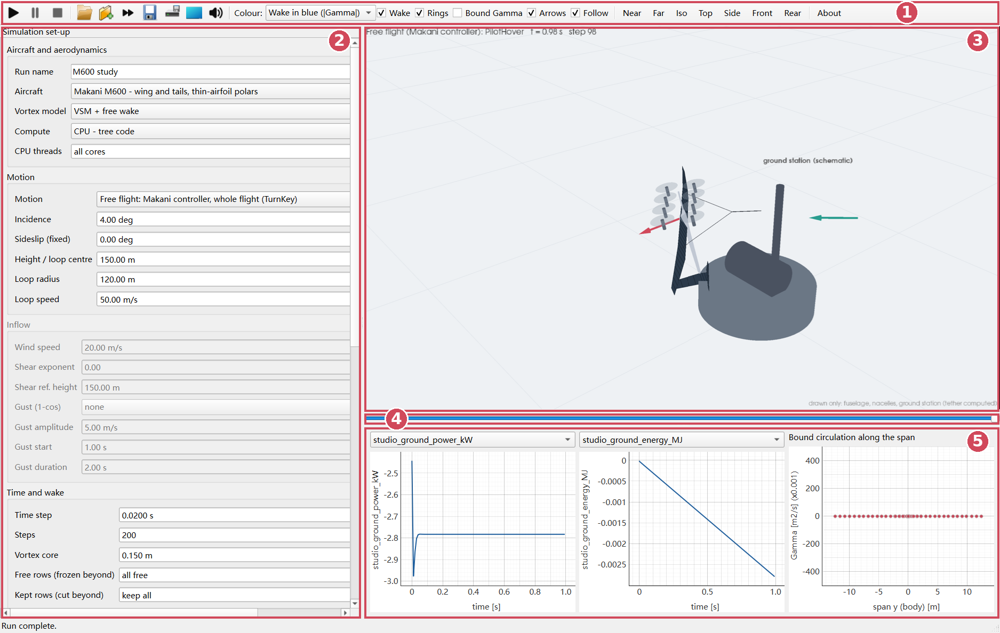
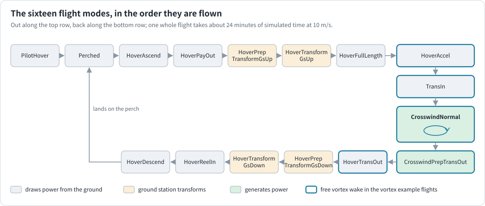

# OpenFAWE Studio 1.0 — user guide

**English** · [中文](user-guide.zh.md) · [OpenFAWE](../README.md) · [Appendix A: record keys](record-keys.md)

OpenFAWE Studio is a Windows program for the simulation of an airborne wind energy kite — the Makani M600 — over a
whole flight: take-off from the perch, hover, tether payout, transition into crosswind flight, crosswind loops that
generate power, the transition back to hover, reel-in and landing on the perch. This guide explains how to install
the program, how to use it, what the example flights contain, what the output files hold, and how the program was
checked. It does not explain the theory; the methods of the aerodynamic module are described in [1].

Contents

1. [What the program computes](#1-what-the-program-computes)
2. [Installation](#2-installation)
3. [The window](#3-the-window)
4. [Example flights](#4-example-flights)
5. [Replay, wake and plots](#5-replay-wake-and-plots)
6. [Export](#6-export)
7. [Running a simulation](#7-running-a-simulation)
8. [Output files](#8-output-files)
9. [The flight modes](#9-the-flight-modes)
10. [Validation](#validation)
11. [Scope and limitations](#11-scope-and-limitations)
12. [Questions and answers](#12-questions-and-answers)
13. [References](#13-references)

---

## 1. What the program computes

**The kite and its ground system.** The M600 is a rigid wing of 25.66 m span with eight rotors. In hover and transition the rotors act as propellers; in crosswind flight they act as
turbines and the electrical power flows down the tether to the ground station. The program computes:

- the rigid-body flight of the kite, driven by Makani's own M600 flight controller (Makani's C source, compiled into a
  library that the program calls every 10 ms);
- the GS02 ground station: platform azimuth, drum and winch, levelwind and the transform between the reel and the
  high-tension configurations;
- the tether, as a lumped-mass line whose free length changes as the drum turns, with the bridle;
- the eight rotors (Makani's Rev4 tables), the motors and the stacked power system, with an energy account for every
  flight mode;
- the aerodynamics of the wing and tails, either from Makani's aerodynamic database (tables) or, in the flying modes,
  from the vortex step method with a free vortex wake and the rotors' vortex rings (the methods of [1]).

**Short aerodynamic windows.** Besides whole flights, the program runs short vortex-method simulations of a wing held
in the wind, flying a circular crosswind loop, or flying Makani's nominal crosswind loop with a tether. Six methods are
offered — the vortex step method (VSM), the lifting line and the vortex lattice, each with a free or a straight wake —
with rotors, gusts and wind shear.

**Hardware.** The large sums of the wake (the velocity that every vortex segment induces on every node) run on all CPU
cores with a tree code, or on an NVIDIA GPU. The program finds out what the computer has.

## 2. Installation

**Requirements.** Windows 10 or 11, 64-bit; 8 GB of memory (16 GB for long vortex flights); about 3 GB of free disk
for the program and the examples, and space for your own runs (a whole table flight stores about 1 GB of records;
a vortex flight with wake frames several GB). An NVIDIA GPU with a current driver is optional.

**Steps.**

1. Download `OpenFAWE-Studio-1.0.0-win64.zip` from the Releases page of the repository.
2. Check the download: in PowerShell, `Get-FileHash .\OpenFAWE-Studio-1.0.0-win64.zip` must print the SHA-256 given on
   the release page.
3. Unzip it to a folder of your choice (not inside `Program Files`; the program writes nothing there, but the numerical
   library keeps a cache in your user folder).
4. Run `OpenFAWE Studio.exe`. The program is not code-signed, so Windows may show "Windows protected your PC": choose
   "More info", then "Run anyway".

**Self-test.** Open a command prompt in the program folder and run

```
start /wait "" "OpenFAWE Studio.exe" --self-test
echo %errorlevel%
```

The program has no console window, so it prints nothing; `start /wait` waits until it has finished (about a minute)
and `echo %errorlevel%` then shows 0 when no part failed.

It opens every example and draws it off screen, flies 20 control periods of the whole flight and compares them with
the same 20 periods computed when the program was built, writes a ParaView file, a CSV file and a two-second video,
and, if the computer has an NVIDIA GPU, compares the GPU wake sum with the CPU tree code. The report
`self-test.json` goes to `%USERPROFILE%\OpenFAWE Studio runs\self-test-<time>`; open it to see each part.
"passed": true means that no part failed; a part that cannot run on this computer is skipped (`null`) - the examples
part when the examples are missing, the GPU part when there is no NVIDIA driver. On another computer than the one the
program was built on, the 20 periods are usually not identical to the last digit (processors and libraries do not all
round the same way). The report then gives, for information, the largest difference scaled by the size of the quantity
(`max_scaled`) and the largest relative difference (`max_relative`, which can be large for a quantity that is nearly
zero, such as the sideslip angle on the perch). Over a whole flight such differences grow ([section 11](#11-scope-and-limitations)).

**The first run is slower.** The numerical kernels are compiled the first time they are used (a minute or two) and
cached in your user folder; later runs start at once.

**Uninstalling.** Delete the program folder, and if you wish `%USERPROFILE%\OpenFAWE Studio runs` (your runs) and
`%LOCALAPPDATA%\numba` (the cache).

## 3. The window



| Area | What it does |
|---|---|
| **1 Toolbar** (top) | Run, Pause, Stop; Open run, Import job run, Play replay; Export CSV, Export ParaView, Screenshot, Export video; colour scheme; the switches Wake, Rings, Bound Gamma, Arrows, Follow; the views Near, Far, Iso, Top, Side, Front, Rear; About. |
| **2 Simulation set-up** (left) | All settings of a new simulation, grouped: aircraft and method, motion, inflow, time stepping and wake, rotors, drawing, free flight. Settings a choice does not use are greyed. |
| **3 3-D view** (centre) | The kite, its wake, the rotors' rings, the tether and the ground station. Drag to rotate, wheel to zoom, right-drag to pan. |
| **4 Time slider** (below the view) | Moves through the stored frames of a run. |
| **5 Plots** (bottom) | Any recorded quantity against time, updated while a simulation runs; on the right, the bound circulation along the span. |
| **Status line** (bottom edge) | What the program is doing, the run's folder and the number of steps. |

## 4. Example flights

The examples are in the program's data folder, `_internal\examples` next to `OpenFAWE Studio.exe`; **Open run**
starts there until you have runs of your own. Each example has a `run` folder that the program opens, and next to it `case.json` (what the flight is), `trajectory.csv` and, for flights with the power
system, `energy-by-mode.csv`.

| Example | Aerodynamics | Wind | What to look at |
|---|---|---|---|
| `e4-tables-10ms` | Makani's aerodynamic database in every mode | uniform 10 m/s | the whole flight, mode by mode, with the power system: the energy used in hover and transition and the energy generated in crosswind |
| `bprime6-vortex-10ms` | vortex step method with free wake and rotor rings in the flying modes; tables in hover and on the perch | uniform 10 m/s | the wake of a whole flight: the helical tip vortices in crosswind |
| `vortex-8ms` | as above | uniform 8 m/s | crosswind loops below break-even: they still use energy |
| `vortex-12ms` | as above | uniform 12 m/s | the flight of the front-page animation |
| `vortex-shear-10ms` | as above | wind shear exponent 1/7, 10 m/s at 21 m | the gain from the faster wind at the kite's height |
| `f3-vortex-turbulent` | as above | IEC 61400-1 normal turbulence (class B, TurbSim), mean 10 m/s | the whole flight in turbulent wind: the controller holding the loops in gusts |
| `cycle-power-curve` | tables; vortex | 6–14 m/s | per flight: the crosswind power, the overhead energy and the break-even crosswind time (CSV with a README) |

**Data use.** The example flights distributed with OpenFAWE Studio 1.0.0 and their results – the program's `examples` folder, the power-curve table, the whole-flight video and the pictures made from them – belong to a manuscript in preparation by Y. Tian and S. Wang. Until that paper is published they may be used to check an installation, to learn the program and to compare with your own simulations, citing this repository (see `CITATION.cff`). They may not be republished, or used as the data of a publication or a thesis, without the author's written permission. Contact: yinong.tian@tecnico.ulisboa.pt. The full terms are in DATA-USE.md in the repository.

The records of the examples are thinned so that the package stays small: the crosswind and transition modes every
0.1 s, hover and the perch every 1 s, plus every change of mode. The flights themselves were computed every 10 ms.
`case.json` states the thinning, the number of records kept and the machine and version that computed the flight.
The five vortex flights carry five saved wake states each, one in each vortex mode (HoverAccel, TransIn,
CrosswindNormal, CrosswindPrepTransOut and HoverTransOut); the wake between them is in the videos on the release page.
`f3-vortex-turbulent` flew in the turbulent wind field described under [Validation](#validation), V5 (IEC 61400-1 normal turbulence,
class B). The field file itself is not bundled; `case.json` names its model, file and SHA-256.

## 5. Replay, wake and plots

1. **Open run** and choose an example's `run` folder (or one of your own runs).
2. **Play replay** steps through the stored frames; the slider moves to any frame.
3. **Colour** chooses how the wake filaments are coloured: in blue by the magnitude of their circulation, by the
   signed circulation (red and blue), or in one colour. **Wake** and **Rings** show or hide the wing's wake and the rotors' rings; **Bound Gamma** colours the
   wing by its bound circulation; **Arrows** shows the wind (green) and the aerodynamic force (red); **Follow** keeps
   the kite in the middle of the view.
4. The plots show the records. Choose the quantities in the plot panel; during a whole flight the default plots are
   the ground power and the ground energy. The mode is written in the 3-D view.

## 6. Export

| Export | What you get | Notes |
|---|---|---|
| **Export CSV** | one row per record, one column per recorded number (vectors and matrices are split into components) | opens in any spreadsheet |
| **Export ParaView** | a folder `paraview` with one `.vtp` file per part (wing surfaces, wake, rings, fuselage, tether, ground station) and stored frame, the trajectory, and `run.pvd`, which ParaView opens as a time series | ParaView 5.10 or newer |
| **Screenshot** | a PNG of the 3-D view | |
| **Export video** | an animated GIF of the stored frames (always available); MP4 if `ffmpeg` is on the PATH | a GIF keeps at most 600 frames; longer runs take every n-th frame |

## 7. Running a simulation

Choose the settings on the left and press **Run**. The simulation runs in its own process; **Pause** and **Stop** act
on it, and what has been computed is kept when you stop. Each run is stored in
`%USERPROFILE%\OpenFAWE Studio runs\<date>-<time>-<name>`.

**Whole flight (Motion: "Free flight").**

| Setting | Meaning |
|---|---|
| Aerodynamics | Makani's aerodynamic database; or the vortex method in the flying modes (the hover and the perch stay on the tables); or the vortex method with the rotor slipstream tube and the induced inflow of the rotors |
| Power system | the motors, the stacked power system and the tether loss, with the energy account |
| Rotor slipstream | the effect of the rotor slipstream on the wing, with the tables |
| Kept wake rows | how many rows of the free wake are kept behind the wing (vortex choices); default 1 872 |
| Periods | control periods of 0.01 s; 0 flies the whole flight (about 144 000 periods) |
| Store frame every / Store wake every | how often a 3-D frame (pose, tether) and a frame with the wake are stored |
| Compute | for the vortex choices: CPU tree code, or CPU and GPU |

A whole flight on Makani's tables takes about three and a half hours on one CPU core; a whole vortex-method
flight takes one to two days, depending on the wake length and on the GPU. The wind of the whole flight is the uniform 10 m/s of the M600 parameter set; the other examples'
winds were set when they were computed.

**Short windows (Motion: fixed, circle, Makani loop).**

| Group | Settings |
|---|---|
| Aircraft and method | four M600 models; six vortex methods; the summation (CPU tree code, CPU direct sum, GPU, CPU + GPU); CPU threads |
| Motion | fixed in the wind with incidence and sideslip; a circular loop (centre height, radius, speed); Makani's nominal loop with a tether |
| Inflow | wind speed; power-law shear and its reference height; a 1 − cos gust along, across or vertical to the wind |
| Time and wake | time step, number of steps, vortex core, rows that move freely, rows kept |
| Rotors | the eight actuator discs with their vortex rings: speed, nodes per ring, core at the surfaces, ring steps kept |
| Drawing | fuselage (drawn, not in the aerodynamics), tether, ground station, how often a frame is stored |

## 8. Output files

A run folder holds:

| File | Content |
|---|---|
| `spec.json` | every setting of the run, the program version, the controller library and its SHA-256, the wind, the reference area and chord |
| `records.jsonl` | one JSON line per time step (short windows) or control period (whole flights): time, mode, pose, velocities, forces and moments, coefficients, tether tension, rotor speeds and thrusts, and — with the power system — the energies of the period |
| `frames/frame_NNNNNN.npz` | the stored 3-D frames (NumPy archives): pose, surfaces, wake nodes and circulations, rings, tether nodes |
| `status.json` | state (running, complete, stopped, failed), number of steps, end of the flight, energy account by mode |
| `settings.json` | (whole flights) the settings of the flight model as it ran |

The examples also have `case.json`, `trajectory.csv` (time, mode, position in the ground frame — x, y, z up, in
metres — the rotation matrix, airspeed, angle of attack, sideslip, bridle tension, free tether length) and
`energy-by-mode.csv`.

**Signs and frames.** Positions are in the ground frame of the flight, z up, the ground at −6.122 m. Ground energy is
positive when it is delivered to the ground. The body axes of `rotation` point from the nose towards the tail (x), to
starboard (y) and up (z); `Xg` is in Makani's ground frame (x north, y east, z down). Every record key with its unit and
meaning: [Appendix A](record-keys.md) (generated from the records of a flight).

## 9. The flight modes

The controller flies sixteen modes.



| Mode | What happens |
|---|---|
| PilotHover | the start: the kite is held in hover by the pilot's commands before the automatic sequence |
| Perched | on the perch of the ground station, rotors idle |
| HoverAscend | lifts off the perch and climbs a few metres |
| HoverPayOut | hovers while the winch pays out the tether |
| HoverPrepTransformGsUp | prepares the ground station's transform to the high-tension configuration |
| HoverTransformGsUp | the ground station rotates its drum and platform into high-tension |
| HoverFullLength | hovers at full tether length |
| HoverAccel | accelerates out of hover |
| TransIn | the transition from hover to crosswind flight |
| CrosswindNormal | crosswind loops: the rotors generate power |
| CrosswindPrepTransOut | prepares the transition out of crosswind |
| HoverTransOut | the transition from crosswind back to hover |
| HoverPrepTransformGsDown | prepares the ground station's transform back to reel |
| HoverTransformGsDown | the ground station rotates back |
| HoverReelIn | hovers while the tether is reeled in |
| HoverDescend | descends onto the perch |

## Validation

Every part of the program was first checked on its own, then coupled to the others and checked again. Every bound
was written down before the check was run. The results below passed on those bounds; the checks that did not pass on
the bound first written, and how they were then read, are listed in [section 11](#11-scope-and-limitations), with what was not checked.

### V1 Aerodynamics against published data

- **Independent code.** The open-source vortex-step-method code [2], given the same input, reproduces the program's
  vortex step method to 1e-9 on the rigid-wing M600 and within 0.3 % in lift and 0.9 % in drag on the TU Delft V3
  kite [1].
- **RANS and wind tunnel (TU Delft V3 kite).** The lift agrees with RANS within 3.1 % [1]; at 5.4° and 7.4° the lift of
  the polar-coupled methods is within −12 % to +5 % of the wind-tunnel measurements. At low incidence the lift, and
  the pitching moment, differ from the measurements for every code compared, RANS included.
- **M600.** The straight-wake methods are within −1.6 % to +0.8 % of the open-source code's lift.

### V2 The free wake

- The wake length needed before a run is fixed by the far field of the starting vortex; the vortex core must stay
  below the narrowest panel width [1].
- **CPU and GPU sums.** The tree code and the GPU give the same induced velocities as the exact direct sum within the
  bounds set before the checks; in double precision the GPU agrees with the CPU tree code to within 2e-15 m/s on wakes
  of 468 to 3 744 rows ([Speed](../README.md#speed) on the repository page).

### V3 Makani's flight controller

- The controller library is compiled from Makani's C source without any change. The program calls it every 10 ms, as
  Makani's simulator does.
- **Windows and Linux builds.** The Windows library was compared with the Linux library on the first 4 000 control
  periods of the whole flight: every discrete quantity (flight mode, gates, ground-station mode) was the same at every
  period and the continuous quantities agreed within 3.6e-12; two runs on Windows were identical to the last bit. The
  Linux library built for another machine (a different system library) flew 42 000 control periods with every flight
  mode beginning at the same period and the ground energy within 9.6e-12 of the reference build.
- **Without the GNU Scientific Library.** The released library replaces the linear-algebra routines it took from the
  GSL by the program's own implementation of the textbook algorithms. They were checked against the GSL on 10 500
  random matrices and on every system the controller solved in its first 2 000 control periods: the QR
  factorisations, column permutations, singular values and error codes agree. The closed loop was then flown for
  42 000 control periods with both libraries: every flight mode began at the same period, and the ground energy
  agreed to 1.0e-11. Finally the whole flight was flown on Windows with the released library: it ended at the same
  control period as the reference (143 601), each of the sixteen flight modes lasted the same number of periods, and
  the net ground energy agreed to 2.7e-11.

### V4 Tether and ground station

- The tether and the GS02 ground station were transcribed from Makani's simulator (C++). Both were compared with
  Makani's own C++ code, compiled unchanged and driven with the same inputs:
  - **Tether** — four cases (full length on a circle, with and without wind; paying out at 2 m/s from 100 to 220 m,
    with and without wind): node positions within 2e-14 of the tether length, node velocities within 4e-12 of 50 m/s,
    end forces within 1.3e-10 relative, the same active nodes at every sample.
  - **Ground station** — reeling in and out at 1 and 2 m/s, the transform to high tension, and holding high tension
    while the detwist follows the loop, 6 001 to 24 001 samples per case: the discrete states (mode, transform stage)
    identical at every sample, the continuous states identical to the last bit or within 3e-19 (relative to the
    larger of the value and 1), the outputs within 1.4e-12 ([section 11](#11-scope-and-limitations)).

### V5 The whole flight

- **The flight completes.** From the perch through the sixteen flight modes in their order and back onto the perch,
  with Makani's gates of every mode passed by the controller itself. Each example's `case.json` gives its duration, and
  `energy-by-mode.csv` the energy of every mode.
- **The energy account closes.** In every control period the energy terms — rotor shafts, aerodynamics, motors
  (electrical and mechanical), the ground, the tether loss and the energy stored in the rotors and the power system —
  add up to within 9.0e-7 times the bound written for them.
- **Repeatable.** The same flight computed twice in two processes gives identical records.
- **Turbulent wind.** The turbulent wind field (IEC 61400-1 normal turbulence model, class B, generated with TurbSim)
  has the requested mean and standard deviations (hub-height turbulence intensity 18.34 %; the three standard
  deviations within 4e-7 of the request; spectra close to the Kaimal model), and the program reads it exactly as
  OpenFAST's InflowWind does: identical to the last bit at 48 050 grid points and at 1 000 random points and times.
- **Vortex method in the whole flight.** The whole flight with the vortex method, the rotor slipstream and the rotors'
  induced inflow (the example `bprime6-vortex-10ms`) was judged on criteria written before it was flown. It ends
  normally (the controller's gain ramp completed at control period 140 797 and the flight ended at 141 297); the energy
  account closes in every period within 9.0e-7 times its bound; and all 53 832 control periods of the five modes that use the vortex method (HoverAccel
  502, TransIn 818, CrosswindNormal 42 022, CrosswindPrepTransOut 9 288, HoverTransOut 1 202) were solved by the vortex
  method. In one of them the full solve did not converge and the program's fallback solved it with the few panels of
  largest residual treated by strip theory.

### V6 Repeatability across machines and restarts

- Records do not depend on whether wake frames are stored: a vortex flight with and without frame storage gives
  identical records, apart from the wall-clock time of each period.
- **Resume.** The computation core can save the state of a flight and continue it in a new process; it was used for
  the long flights behind the examples. A flight killed twice and continued each time gave records, energy account
  and end identical to the last bit to the same flight run without interruption (apart from the wall-clock time of each
  period): on Linux on Makani's tables and with the vortex method in hover, and on Windows with the GPU. The studio
  1.0.0 does not offer resume: a stopped flight keeps its records up to the stop and is not continued.
- On another machine a flight is in general not identical to the last bit; the controller library agrees across
  machines as stated in [V3](#v3-makanis-flight-controller), but over a whole flight the differences grow ([section 11](#11-scope-and-limitations)).

## 11. Scope and limitations

- The kite is a rigid body; the wing does not bend or twist.
- The controller runs with ideal sensors: it reads the simulated state directly, without Makani's estimator and sensor
  models.
- In hover and on the perch the aerodynamics come from Makani's whole-aircraft tables, also in the vortex-method
  flights.
- The tether does not interact with the ground (no ground contact in the flights of this program).
- Only the M600 is offered for whole flights; its control and data are Makani's.
- The comparison with Makani's flight-test records is reported in the paper on the whole flight and is not part of
  this program.
- **Differences in the last digits grow over a whole flight.** The closed loop amplifies them: two whole flights whose
  wind-shear exponent differed by one part in 10^12 ended 20.9 s apart (1 338.6 s and 1 317.7 s) with net ground
  energies 1.3 % apart (−387.8 and −393.0 MJ), both with 20 crosswind loops. A flight on another computer should be
  compared with the examples at this level, not digit by digit.
- **The vortex-method examples** (all but `e4-tables-10ms`) were computed with the research build of Makani's
  controller library, which uses the GNU Scientific Library; the program contains the build without it ([V3](#v3-makanis-flight-controller)). Their
  records are kept as computed and were not recomputed with the released library.
- **Checks that did not pass on the bound first written.** Each was then read in a second way, written after the
  result and stated as a loosening; the release rests on the checks that followed it.
  - *The linear algebra without the GSL, function by function ([V3](#v3-makanis-flight-controller)).* The solutions of the controller's 8×5
    thrust-allocation systems (condition number about 2.5e4) differed from the GSL's by up to 6.6e-11 against a bound
    of 1e-12·(1 + |x|) per component, and the rank of 248 rank-deficient random matrices differed when counted with a
    tolerance below their rounding noise. Read against the rounding scale of each system (|Δx| ≤ 8·κ·ε·|x|), the
    largest ratio was 4.4 of 8; with a tolerance above the rounding noise every rank agreed. The closed-loop and
    whole-flight checks of V3 then passed on the bounds first written.
  - *The ground station's outputs ([V4](#v4-tether-and-ground-station)).* In two of the four comparisons with Makani's C++ (the transform to high
    tension, holding high tension) one component of the tether force differed by 1.38e-12 against the bound of 1e-12
    written for every component; the states agreed as stated in [V4](#v4-tether-and-ground-station). Compared as vectors by their norm, the outputs
    agree within 1.1e-15.
- **Checks that did not pass on the bound first written and were not read a second way.** In each the cause is in
  a method of Makani's simulator that the program reproduces as it is; nothing was changed for them, and the release
  does not rest on them ([V4](#v4-tether-and-ground-station) rests on the comparison with Makani's C++ code).
  - *The variable-length tether at full length against the fixed-length tether.* The node forces differed by 7.8e-11
    (relative) against a bound of 1e-12: Makani finds the length of the first segment by repeated addition, which
    differs from half a segment by 8e-14 m, and the tether's stiffness enlarges that.
  - *The static catenary with a short tether.* At the full 425.8 m, tension and sag were within 0.30 % of the
    catenary; at 80 m the tension differed by up to 2.7 % and the sag by 2.4 % to 4.0 %, and at 200 m by 0.6 % to
    1.0 %, against a bound of 0.5 %: the tether has Makani's 19 nodes, which is coarse for a short tether.
  - *At rest on the perch.* With gravity and the contacts only (no tether), the kite moved 40 mm and turned 0.8° in
    10 s, against bounds of 5 mm and 0.1°; with the controller and the tether it moved 20 mm. Makani's contact
    friction is viscous below a sliding speed of 1 m/s (there is no static friction), so the kite creeps. In a
    whole flight the kite is on the perch for some ten seconds.
- Results are research output and are not validated for design, certification or safety decisions.

## 12. Questions and answers

**The program does not start.** Unzip the whole folder first; run it from a folder you can write to; check that your
antivirus did not quarantine a file. Run the self-test ([section 2](#2-installation)) and read its report `self-test.json`.

**The GPU choices are grey.** The program did not find a usable NVIDIA GPU: update the driver, or use the CPU choices
(they give the same results).

**MP4 export fails.** Install ffmpeg and put it on the PATH, or export a GIF.

**My numbers differ from the examples.** Floating-point rounding differs between processors and thread counts, and
over a whole flight the closed loop amplifies such differences; [section 11](#11-scope-and-limitations) says how large they become.

## 13. References

[1] Y. Tian, S. Wang, *Free-vortex-wake dynamics of airborne wind energy kites in crosswind flight*, arXiv:2610.37313
(2026). [doi:10.48550/arXiv.2610.37313](https://doi.org/10.48550/arXiv.2610.37313)

[2] O. Cayon, M. Gaunaa, R. Schmehl, *Fast aero-structural model of a leading-edge inflatable kite*, Energies 16 (2023)
3061. [doi:10.3390/en16073061](https://doi.org/10.3390/en16073061). Code: [Vortex-Step-Method](https://github.com/awegroup/Vortex-Step-Method), TU Delft
