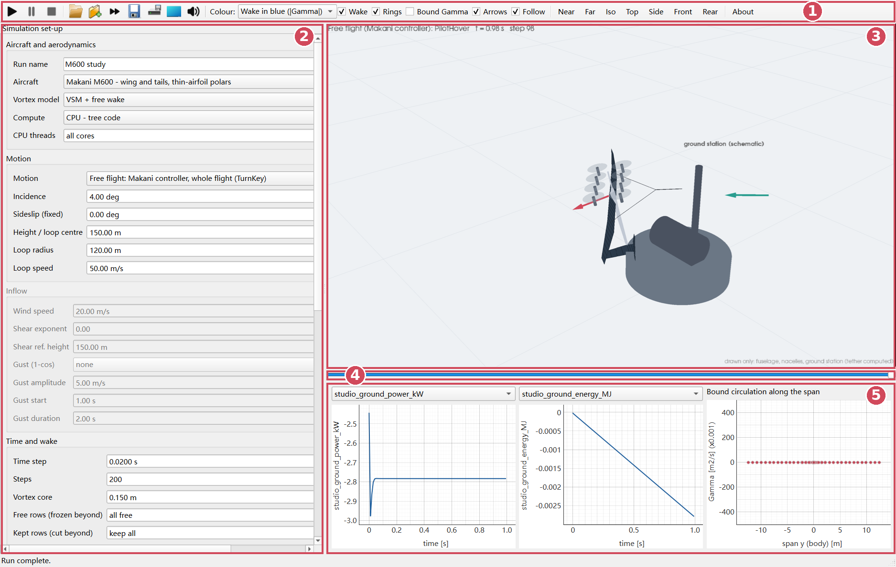
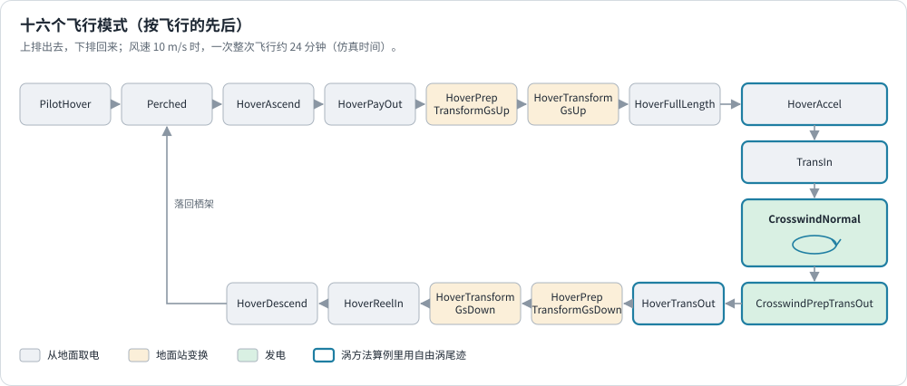

# OpenFAWE Studio 1.0 帮助文档

[English](user-guide.md) · **中文** · [OpenFAWE 首页](../README.md) · [附录 A：记录里的键](record-keys.zh.md)

OpenFAWE Studio 是一个 Windows 程序，用来仿真空中风能风筝（Makani M600）的整次飞行：从栖架起飞、悬停、放出系绳、转入横风飞行、在横风圈里发电、转回悬停、收绳、落回栖架。本文说明怎么安装、怎么用、算例里有什么、输出文件是什么，以及程序是怎样检验的。本文不讲理论；气动模块的方法见文献 [1]。

目录

1. [程序算什么](#1-程序算什么)
2. [安装](#2-安装)
3. [界面](#3-界面)
4. [算例](#4-算例)
5. [回放、尾迹与曲线](#5-回放尾迹与曲线)
6. [导出](#6-导出)
7. [自己计算](#7-自己计算)
8. [输出文件](#8-输出文件)
9. [飞行模式](#9-飞行模式)
10. [验证](#验证)
11. [适用范围与局限](#11-适用范围与局限)
12. [常见问题](#12-常见问题)
13. [参考文献](#13-参考文献)

---

## 1. 程序算什么

**风筝与地面系统。** M600 是一架翼展 25.66 m 的刚性翼，带八个旋翼。悬停与转换时旋翼当螺旋桨用；横风飞行时旋翼当涡轮用，电能沿系绳送到地面站。程序计算：

- 风筝的刚体飞行，由 Makani 自己的 M600 飞行控制器驱动（Makani 的 C 源码编成的库，程序每 10 ms 调用一次）；
- GS02 地面站（ground station）：平台方位、卷筒与绞盘（winch）、排绳器（levelwind），以及收放绳与高张力两种构型之间的变换；
- 系绳（tether）：集中质量模型，自由长度随卷筒转动而变，带吊索（bridle）；
- 八个旋翼（Makani 的 Rev4 表）、电机与串联供电系统（stacked power system），并给出每个飞行模式的电能账；
- 机翼与尾翼的气动：用 Makani 的气动数据库（查表），或者在飞行模式里用涡步法（vortex step method, VSM）加自由涡尾迹（free vortex wake）与旋翼涡环（方法见 [1]）。

**气动短窗。** 除了整次飞行，程序还能算较短的涡方法算例：机翼固定在风里、沿圆形横风圈飞、或者带系绳沿 Makani 的名义横风圈飞。可选六种方法：涡步法、升力线（lifting line）、涡格法（vortex lattice），各带自由尾迹或直尾迹；可加旋翼、阵风与风切变。

**硬件。** 尾迹的大规模求和（每个涡段对每个节点的诱导速度）用树代码（tree code）在所有 CPU 核上算，或在 NVIDIA 显卡上算。程序自己判断电脑有什么。

## 2. 安装

**要求。** Windows 10 或 11，64 位；内存 8 GB（长的涡方法飞行要 16 GB）；程序与算例约占 3 GB 磁盘，另留空间给自己的运行（一次查表整次飞行的记录约 1 GB；带尾迹帧的涡方法飞行有几 GB）。NVIDIA 显卡（驱动要新）可有可无。

**步骤。**

1. 在仓库的 Releases 页面下载 `OpenFAWE-Studio-1.0.0-win64.zip`。
2. 核对下载：在 PowerShell 里运行 `Get-FileHash .\OpenFAWE-Studio-1.0.0-win64.zip`，打印的 SHA-256 要与发布页上的相同。
3. 解压到任意文件夹（不要放在 `Program Files` 里；程序不往那里写东西，但数值库会在用户目录里存缓存）。
4. 运行 `OpenFAWE Studio.exe`。程序没有代码签名，Windows 可能提示“Windows 已保护你的电脑”：点“更多信息”，再点“仍要运行”。

**自检。** 在程序文件夹里打开命令提示符，运行

```
start /wait "" "OpenFAWE Studio.exe" --self-test
echo %errorlevel%
```

程序没有控制台窗口，所以什么也不打印；`start /wait` 会等它做完（约一分钟），`echo %errorlevel%` 显示 0 表示没有一项不过。

它会：打开每个算例并在屏幕外画一帧；飞整次飞行的前 20 个控制周期，与打包时算出的同样 20 个周期比较；写一个 ParaView 文件、一个 CSV 文件与一段 2 秒的视频；电脑有 NVIDIA 显卡时，再把显卡上的尾迹求和与 CPU 树代码比较。报告 `self-test.json` 写在 `%USERPROFILE%\OpenFAWE Studio runs\self-test-<时间>`，打开它看每一项。"passed": true 表示没有一项不过；在这台电脑上做不了的项记为跳过（`null`）：没有算例时的算例一项，没有 NVIDIA 驱动时的显卡一项。在打包用的电脑以外的电脑上，这 20 个周期一般不会每一位都相同（不同处理器与库的舍入不完全一样）。报告里会给出两个数，仅供参考：按量的大小缩放后的最大差（`max_scaled`）与最大相对差（`max_relative`；接近零的量，比如在栖架上的侧滑角，相对差可以很大）。整次飞行里这类差会放大（[第 11 节](#11-适用范围与局限)）。

**第一次运行较慢。** 数值核函数第一次用时要编译（一两分钟），之后存在用户目录里，再运行就直接开始。

**卸载。** 删掉程序文件夹即可；如果需要，再删 `%USERPROFILE%\OpenFAWE Studio runs`（自己的运行）与 `%LOCALAPPDATA%\numba`（缓存）。

## 3. 界面



（程序的界面是英文的，截图照原样。）

| 区域 | 作用 |
|---|---|
| **1 工具栏**（上） | 运行、暂停、停止；打开运行、导入作业运行、播放回放；导出 CSV、导出 ParaView、截图、导出视频；配色；尾迹、涡环、附着环量、箭头、跟随五个开关；近、远、斜、俯、侧、前、后七个视角；关于。 |
| **2 仿真设置**（左） | 新仿真的全部设置，按组排：飞机与方法、运动、来流、时间步与尾迹、旋翼、显示、整次飞行。当前选择用不到的设置变灰。 |
| **3 三维视图**（中） | 风筝、尾迹、旋翼涡环、系绳与地面站。左键拖动旋转，滚轮缩放，右键拖动平移。 |
| **4 时间滑块**（视图下方） | 在一次运行存下的帧之间移动。 |
| **5 曲线**（下） | 任意记录量随时间的曲线，计算时实时更新；右边是沿展向的附着环量。 |
| **状态栏**（最底下一行） | 程序在做什么、运行所在文件夹与步数。 |

## 4. 算例

算例在程序的数据文件夹里，即 `OpenFAWE Studio.exe` 旁边的 `_internal\examples`；自己还没有运行时，**打开运行**就从这里开始。每个算例有一个程序能打开的 `run` 文件夹，旁边是 `case.json`（这次飞行是什么）、`trajectory.csv`，带电力系统的还有 `energy-by-mode.csv`。

| 算例 | 气动 | 风 | 看什么 |
|---|---|---|---|
| `e4-tables-10ms` | 各模式都用 Makani 的气动数据库 | 均匀 10 m/s | 整次飞行逐模式的电能：悬停与转换耗电，横风发电 |
| `bprime6-vortex-10ms` | 飞行模式用涡步法、自由尾迹与旋翼涡环；悬停与栖架用查表 | 均匀 10 m/s | 整次飞行的尾迹：横风圈里的螺旋翼尖涡 |
| `vortex-8ms` | 同上 | 均匀 8 m/s | 横风圈还在耗电，没有盈亏平衡 |
| `vortex-12ms` | 同上 | 均匀 12 m/s | 首页动图里的那次飞行 |
| `vortex-shear-10ms` | 同上 | 切变指数 1/7，21 m 处 10 m/s | 风筝所在高度风更大，横风功率更高 |
| `f3-vortex-turbulent` | 同上 | IEC 61400-1 正常湍流（B 级，TurbSim），平均 10 m/s | 湍流风里的整次飞行：控制器在阵风里保持横风圈 |
| `cycle-power-curve` | 查表；涡方法 | 6–14 m/s | 每次飞行的横风功率、固定开销与盈亏平衡所需的横风时长（CSV，附说明） |

**数据使用。**随 OpenFAWE Studio 1.0.0 发布的示例飞行及其结果——程序的 `examples` 文件夹、功率曲线表、整次飞行视频以及用它们做的图——属于 Y. Tian 与 S. Wang 正在准备的一篇论文。在该论文发表之前，它们可用于检查安装、学习使用本程序以及与您自己的仿真结果对比，并请引用本仓库（见 `CITATION.cff`）；未经作者书面许可，不得重新发布，也不得作为论文或学位论文的数据使用。联系：yinong.tian@tecnico.ulisboa.pt。条款全文见仓库里的 DATA-USE.md。

为了让软件包不太大，算例的记录做了精简：横风与转换模式每 0.1 s 一条，悬停与栖架每 1 s 一条，另留每次模式切换。飞行本身是每 10 ms 算一次的。`case.json` 写明精简的做法、留下的记录条数，以及算这次飞行的机器与版本。五次涡方法飞行各带 5 个存下的尾迹状态，每个涡方法模式一个（HoverAccel、TransIn、CrosswindNormal、CrosswindPrepTransOut、HoverTransOut）；其间的尾迹见发布页上的视频。`f3-vortex-turbulent` 是在[验证](#验证) V5 所说的湍流风场（IEC 61400-1 正常湍流，B 级）里飞的；风场文件本身不随包附带，`case.json` 里写了它的模型、文件名与 SHA-256。

## 5. 回放、尾迹与曲线

1. 点**打开运行**，选一个算例的 `run` 文件夹（或自己的运行）。
2. **播放回放**逐帧播放；滑块可以跳到任意一帧。
3. **配色**决定尾迹涡丝的颜色：按环量大小的蓝色、按带符号的环量（红蓝），或单色。**尾迹**与**涡环**显示或隐藏机翼尾迹与旋翼涡环；**附着环量**按附着环量给机翼上色；**箭头**显示风（绿）与气动力（红）；**跟随**让风筝保持在视图中央。
4. 曲线显示记录量。在曲线面板里选量；整次飞行默认显示地面功率与地面电能。三维视图里写着当前模式。

## 6. 导出

| 导出 | 得到什么 | 说明 |
|---|---|---|
| **导出 CSV** | 每条记录一行，每个记录的数一列（向量与矩阵拆成分量） | 任何表格软件都能打开 |
| **导出 ParaView** | `paraview` 文件夹：每个部件（机翼面、尾迹、涡环、机身、系绳、地面站）每个存下的帧一个 `.vtp`，轨迹一个，另有 `run.pvd`，ParaView 按时间序列打开 | ParaView 5.10 或更新 |
| **截图** | 三维视图的 PNG | |
| **导出视频** | 存下的帧做成 GIF 动图（总能用）；PATH 里有 `ffmpeg` 时可导出 MP4 | GIF 最多 600 帧，更长的运行每隔 n 帧取一帧 |

## 7. 自己计算

在左边选好设置，点**运行**。仿真在单独的进程里算；**暂停**、**停止**作用于它，停止后已算的部分保留。每次运行存在 `%USERPROFILE%\OpenFAWE Studio runs\<日期>-<时间>-<名字>`。

**整次飞行（运动选“Free flight”）。**

| 设置 | 含义 |
|---|---|
| 气动 | Makani 的气动数据库；或飞行模式用涡方法（悬停与栖架仍用查表）；或涡方法加旋翼滑流管与旋翼诱导入流 |
| 电力系统 | 电机、串联供电系统与系绳损耗，带电能账 |
| 旋翼滑流 | 查表时旋翼滑流对机翼的作用 |
| 保留的尾迹排数 | 机翼后面保留多少排自由尾迹（涡方法）；默认 1 872 |
| 周期数 | 0.01 s 一个控制周期；0 表示飞整次（约 144 000 个周期） |
| 每隔多少周期存一帧 / 存一帧尾迹 | 三维帧（姿态、系绳）与带尾迹的帧的存储间隔 |
| 计算 | 涡方法时：CPU 树代码，或 CPU 加 GPU |

查表的整次飞行在一个 CPU 核上约三个半小时；涡方法的整次飞行要一到两天，取决于尾迹长度与显卡。整次飞行的风是 M600 参数集里的均匀 10 m/s；其他算例的风在算的时候另设。

**气动短窗（运动选固定、圆形圈或 Makani 圈）。**

| 组 | 设置 |
|---|---|
| 飞机与方法 | 四套 M600 模型；六种涡方法；求和方式（CPU 树代码、CPU 直接求和、GPU、CPU + GPU）；CPU 线程数 |
| 运动 | 固定在风里（迎角与侧滑角）；圆形圈（圆心高度、半径、速度）；带系绳的 Makani 名义圈 |
| 来流 | 风速；幂律切变及其参照高度；沿风向、横向或竖向的 1 − cos 阵风 |
| 时间与尾迹 | 时间步、步数、涡核、自由运动的排数、保留的排数 |
| 旋翼 | 八个作动盘（actuator disc）及其涡环：转速、每环节点数、贴近机翼面时的涡核、保留的涡环步数 |
| 显示 | 机身（只画，不进气动）、系绳、地面站、存帧间隔 |

## 8. 输出文件

一个运行文件夹里有：

| 文件 | 内容 |
|---|---|
| `spec.json` | 这次运行的全部设置、程序版本、控制器库及其 SHA-256、风、参考面积与弦长 |
| `records.jsonl` | 每个时间步（短窗）或控制周期（整次飞行）一行 JSON：时间、模式、姿态、速度、力与力矩、系数、系绳张力、旋翼转速与推力，带电力系统时还有这个周期的各项电能 |
| `frames/frame_NNNNNN.npz` | 存下的三维帧（NumPy 压缩包）：姿态、机翼面、尾迹节点与环量、涡环、系绳节点 |
| `status.json` | 状态（运行中、完成、停止、失败）、步数、飞行如何结束、逐模式电能账 |
| `settings.json` | （整次飞行）飞行模型运行时的设置 |

算例另有 `case.json`、`trajectory.csv`（时间、模式、地面坐标系里的位置——x、y、z 向上，单位米——旋转矩阵、空速、迎角、侧滑角、吊索张力、系绳自由长度）与 `energy-by-mode.csv`。

**符号与坐标系。** 位置在飞行的地面坐标系里，z 向上，地面在 −6.122 m。地面电能为正表示送到地面。`rotation` 的机体轴：x 从机头指向机尾，y 指向右翼，z 向上；`Xg` 在 Makani 的地面坐标系里（x 向北，y 向东，z 向下）。每个记录键的单位与含义见[附录 A](record-keys.zh.md)（由一次飞行的记录生成）。

## 9. 飞行模式

控制器依次飞十六个模式。



| 模式 | 做什么 |
|---|---|
| PilotHover | 开始：在自动流程之前，由操作者的指令把风筝保持在悬停 |
| Perched | 停在地面站的栖架上，旋翼怠速 |
| HoverAscend | 离开栖架，爬升几米 |
| HoverPayOut | 悬停，绞盘放出系绳 |
| HoverPrepTransformGsUp | 准备地面站变换到高张力构型 |
| HoverTransformGsUp | 地面站把卷筒与平台转到高张力构型 |
| HoverFullLength | 在系绳全长处悬停 |
| HoverAccel | 从悬停加速 |
| TransIn | 从悬停转入横风飞行 |
| CrosswindNormal | 横风圈：旋翼发电 |
| CrosswindPrepTransOut | 准备退出横风 |
| HoverTransOut | 从横风转回悬停 |
| HoverPrepTransformGsDown | 准备地面站变换回收放绳构型 |
| HoverTransformGsDown | 地面站转回 |
| HoverReelIn | 悬停，收回系绳 |
| HoverDescend | 下降，落回栖架 |

## 验证

程序的每个部分都先单独检验，再与其他部分耦合后再检验。每项检验的界都在运行之前写定。下面的结果都是按这些界通过的；按最初写的界没有通过的检验、以及之后怎样读的，连同没有检验的，写在第 11 节。

### V1 气动对公开数据

- **独立程序。** 开源的涡步法程序 [2] 用同样的输入，与本程序的涡步法在刚性翼 M600 上一致到 1e-9，在 TU Delft V3 风筝上升力差 0.3 %、阻力差 0.9 % 以内 [1]。
- **RANS 与风洞（TU Delft V3 风筝）。** 升力与 RANS 相差 3.1 % 以内 [1]；在 5.4° 与 7.4° 迎角，带翼型极曲线耦合的方法的升力在风洞测量的 −12 % 到 +5 % 之间。小迎角下的升力与俯仰力矩，所有参与比较的程序（包括 RANS）都与测量有差别。
- **M600。** 直尾迹各方法的升力在开源程序的 −1.6 % 到 +0.8 % 之间。

### V2 自由尾迹

- 运行前需要的尾迹长度由起动涡的远场决定；涡核要小于最窄的面元宽度 [1]。
- **CPU 与 GPU 求和。** 树代码与 GPU 给出的诱导速度，与精确的直接求和之差都在检验前写定的界内；双精度时 GPU 与 CPU 树代码在 468 到 3 744 排的尾迹上相差不到 2e-15 m/s（见仓库首页的[“速度”](../README.md#speed)一节）。

### V3 Makani 的飞行控制器

- 控制器库由 Makani 的 C 源码不改一字地编出来。程序每 10 ms 调用一次，与 Makani 的仿真器相同。
- **Windows 版与 Linux 版。** 在整次飞行的前 4 000 个控制周期上比较 Windows 库与 Linux 库：每个离散量（飞行模式、门槛、地面站模式）每个周期都相同，连续量相差 3.6e-12 以内；Windows 上两次运行逐位相同。为另一台机器（不同的系统库）编的 Linux 库飞了 42 000 个控制周期，每个飞行模式开始的周期都相同，地面电能与参照库相差 9.6e-12 以内。
- **不含 GNU 科学计算库（GSL）。** 发布的控制器库把原来取自 GSL 的线性代数函数换成了本程序按教科书算法写的实现。它们在 10 500 个随机矩阵上、以及控制器在前 2 000 个控制周期里实际求解的全部方程组上与 GSL 比较：QR 分解、列置换、奇异值与错误码都一致。随后两个库各飞 42 000 个控制周期的闭环：每个飞行模式开始的周期都相同，地面电能相差 1.0e-11。最后用发布的 Windows 库飞了一次整次飞行：结束于与参照相同的控制周期（第 143 601 个），十六个飞行模式各自的周期数都相同，净地面电能相对差 2.7e-11。

### V4 系绳与地面站

- 系绳与 GS02 地面站由 Makani 仿真器的 C++ 代码转写。两者都与 Makani 自己的 C++ 代码（不改一字地编译、同样的输入驱动）比较过：
  - **系绳**：四个算例（全长沿圆周运动，有风与无风；以 2 m/s 从 100 m 放到 220 m，有风与无风）：节点位置差在系绳长度的 2e-14 以内，节点速度差在 50 m/s 的 4e-12 以内，两端的力相对差在 1.3e-10 以内，每个采样的有效节点都相同。
  - **地面站**：以 1 与 2 m/s 收放绳、变换到高张力、保持高张力并让解扭跟随圈角，每个算例 6 001 到 24 001 个采样：每个采样的离散状态（模式、变换阶段）都相同，连续状态逐位相同或在 3e-19 以内（相对于数值与 1 中较大者），输出在 1.4e-12 以内（见[第 11 节](#11-适用范围与局限)）。

### V5 整次飞行

- **飞得完。** 从栖架起飞，按顺序经过十六个飞行模式，落回栖架；每个模式的门槛都由控制器自己判过。每个算例的 `case.json` 给出时长，`energy-by-mode.csv` 给出逐模式电能。
- **电能账闭合。** 每个控制周期里，各项能量——旋翼轴、气动、电机（电与机械）、地面、系绳损耗、旋翼与电力系统里储存的能量——相加，在为它写定的界的 9.0e-7 倍以内。
- **可重复。** 同一次飞行在两个进程里各算一次，记录逐位相同。
- **湍流风。** 湍流风场（IEC 61400-1 正常湍流模型，B 级，由 TurbSim 生成）的平均值与标准差符合要求（轮毂高度湍流强度 18.34 %；三个方向的标准差与要求相差 4e-7 以内；频谱接近 Kaimal 模型）；程序读取风场与 OpenFAST 的 InflowWind 完全一样：在 48 050 个格点以及 1 000 个随机点与随机时刻上逐位相同。
- **整次飞行里的涡方法。** 带旋翼滑流与旋翼诱导来流的涡方法整次飞行（算例 `bprime6-vortex-10ms`）按飞之前写定的判据判过：正常结束（控制器的增益爬升在第 140 797 个控制周期完成，飞行在第 141 297 个周期结束）；每个周期的电能账闭合在界的 9.0e-7 倍以内；用涡方法的五个模式（HoverAccel 502、TransIn 818、CrosswindNormal 42 022、CrosswindPrepTransOut 9 288、HoverTransOut 1 202 个周期）共 53 832 个控制周期全部由涡方法解出。其中 1 个周期完整的解不收敛，程序按既定的回退，把残差最大的几块面元按条带理论计算后解出。

### V6 跨机器与断点续算的可重复性

- 记录与是否存尾迹帧无关：同一次涡方法飞行存帧与不存帧，记录除每个周期的计时外完全相同。
- **断点续算。** 计算核心可以存下飞行的状态，在新进程里接着算；算例背后的长飞行用过它。一次飞行被杀两次、每次接着算，记录、电能账与结束都与不中断的同一次飞行逐位相同（每个周期的墙钟时间除外）：在 Linux 上用 Makani 的表、以及悬停也用涡方法的情形，在 Windows 上带 GPU 的情形。Studio 1.0.0 不提供续算：停下的飞行保留停下之前的记录，不再接着算。
- 在其他机器上，飞行一般不会每一位都相同；控制器库跨机器的一致程度见 [V3](#v3-makani-的飞行控制器)，但整次飞行里这些差会放大（[第 11 节](#11-适用范围与局限)）。

## 11. 适用范围与局限

- 风筝是刚体，机翼不弯不扭。
- 控制器按理想传感器运行：直接读仿真状态，不经过 Makani 的估计器与传感器模型。
- 悬停与栖架阶段的气动来自 Makani 的整机表，涡方法的飞行也一样。
- 系绳与地面没有相互作用（本程序的飞行不算系绳触地）。
- 整次飞行只有 M600；它的控制与数据来自 Makani。
- 与 Makani 外场飞行记录的比较写在关于整次飞行的论文里，不在本程序里。
- **末位的差在整次飞行里会放大。** 闭环会把它们放大：两次整次飞行，风切变指数只差 10^12 分之一，结束时间差 20.9 s（1 338.6 s 与 1 317.7 s），净地面电能差 1.3 %（−387.8 与 −393.0 MJ），都飞了 20 个横风圈。在别的电脑上算的飞行，应在这个量级上与算例比较，而不是逐位比较。
- **涡方法的算例**（除 `e4-tables-10ms` 以外）是用 Makani 控制器库的研究版算的，它用 GNU 科学计算库（GSL）；程序里带的是不含 GSL 的版本（[V3](#v3-makani-的飞行控制器)）。这些算例的记录保持原样，没有用发布的库重算。
- **按最初写的界没有通过的检验。** 每一项之后都另用一种读法判过；那种读法是在结果出来之后写的，写明是放宽。发布依据的是其后的检验。
  - *不含 GSL 的线性代数，逐个函数（[V3](#v3-makani-的飞行控制器)）。* 控制器 8×5 的推力分配方程组（条件数约 2.5e4）的解与 GSL 的相差最大 6.6e-11，而每个分量写的界是 1e-12·(1 + |x|)；248 个秩亏随机矩阵用低于其舍入噪声的容差数秩时，秩不同。按每个方程组的舍入量级（|Δx| ≤ 8·κ·ε·|x|）读，最大的比是 4.4（界 8）；用高于舍入噪声的容差，秩全部相同。随后 V3 的闭环与整次飞行检验都按最初写的界通过。
  - *地面站的输出（[V4](#v4-系绳与地面站)）。* 与 Makani 的 C++ 比较的四个算例中有两个（变换到高张力、保持高张力），系绳力的一个分量差 1.38e-12，而每个分量写的界是 1e-12；状态如 [V4](#v4-系绳与地面站) 所述。按向量的模比较，输出相差在 1.1e-15 以内。
- **写了界、没有通过、之后也没有换读法的检验。** 原因都在照搬的 Makani 仿真器的做法本身；程序没有为此改动，发布也不以它们为依据（[V4](#v4-系绳与地面站) 依据的是与 Makani 的 C++ 代码的比较）。
  - *可变长度的系绳在全长时与定长系绳一致。* 节点力的相对差 7.8e-11，写的界是 1e-12：Makani 用逐段累加求第一段的长度，与半段长度差 8e-14 m，经系绳的刚度放大。
  - *静态悬链线，短绳。* 全长 425.8 m 时，张力与垂度同悬链线的差在 0.30 % 以内；80 m 时张力差到 2.7 %、垂度差 2.4 % 到 4.0 %，200 m 时差 0.6 % 到 1.0 %，写的界是 0.5 %：系绳用的是 Makani 的 19 个节点，绳短时这个离散偏粗。
  - *停在栖架上不动。* 只有重力与接触、没有系绳时，机翼 10 s 里移动 40 mm、姿态变化 0.8°，写的界是 5 mm 与 0.1°；带控制器与系绳时移动 20 mm。Makani 的接触摩擦在滑动速度 1 m/s 以下是黏性的，没有静摩擦，机翼会缓慢蠕动。整次飞行里机翼在栖架上只停十来秒。
- 计算结果是研究结果，不能用于设计、认证或安全方面的决定。

## 12. 常见问题

**程序打不开。** 先把整个文件夹解压；从能写入的文件夹运行；看杀毒软件是否隔离了文件。运行自检（[第 2 节](#2-安装)），看它的报告 `self-test.json`。

**GPU 选项是灰的。** 程序没有找到可用的 NVIDIA 显卡：更新驱动，或用 CPU 的选项（结果相同）。

**MP4 导出失败。** 安装 ffmpeg 并加到 PATH，或者导出 GIF。

**我的数与算例不同。** 不同处理器与线程数的浮点舍入不同，整次飞行的闭环还会把这类差放大；[第 11 节](#11-适用范围与局限)写明了会放大到多少。

## 13. 参考文献

[1] Y. Tian, S. Wang, *Free-vortex-wake dynamics of airborne wind energy kites in crosswind flight*, arXiv:2610.37313（2026）。[doi:10.48550/arXiv.2610.37313](https://doi.org/10.48550/arXiv.2610.37313)

[2] O. Cayon, M. Gaunaa, R. Schmehl, *Fast aero-structural model of a leading-edge inflatable kite*, Energies 16（2023）3061。[doi:10.3390/en16073061](https://doi.org/10.3390/en16073061)。代码：Vortex-Step-Method，TU Delft，https://github.com/awegroup/Vortex-Step-Method
